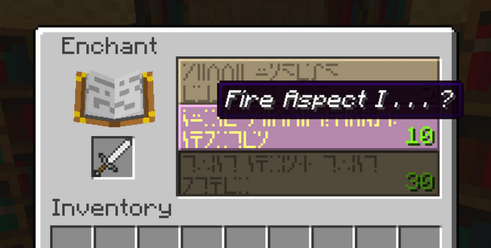

# ViaEnchant

Shows 1.8+ enchanting tooltips for MC 1.7.x when joined to a 1.8+ server with ViaProxy.
Not affiliated with ViaVersion.

## How to install:
Option 1 (better):
- Install on both ViaProxy and MC Forge
1. Download both newest 'ViaProxy' and 'forge-1.7.10' files from the Releases.
2. Download ViaProxy if you haven't already.
3. In the same folder where you have ViaProxy, create a folder named 'plugins' and place there the 'ViaProxy' file. 
4. Place the 'forge-1.7.10' file in your Minecraft mods folder.
5. Start ViaProxy and MC and you're done! Enchant options will be displayed as tooltips.
6. (optional) Configure the ViaProxy plugin: It creates its own folder in the ViaProxy's plugins directory, you can edit the chat-fallback and debug settings there.

Option 2:
- Install only on ViaProxy
1. Download the newest 'ViaProxy' file from releases.
2. Download ViaProxy if you haven't already.
3. In the same folder where you have ViaProxy, create a folder named 'plugins' and place there the 'ViaProxy' file. 
4. Start ViaProxy and MC and you're done! Enchant options will be displayed in chat.
5. (optional) Configure the ViaProxy plugin: It creates its own folder in the ViaProxy's plugins directory, you can edit the chat-fallback and debug settings there.

## Wanna build it yourself?

Plugin (needs a JDK 17+ and the ViaProxy jar):

    cd viaproxy-plugin
    ./build.sh /path/to/ViaProxy.jar

Forge mod (needs a JDK 17+ for Gradle, everything else is downloaded):

    cd forge-mod
    JAVA_HOME=/usr/lib/jvm/temurin-17-jdk VERSION=1.1.0 ./gradlew build   # jar: build/libs/viaenchant-1.1.0.jar

## Test

`viaproxy-plugin/test/e2e_test.py` starts a mock 1.8 server, ViaProxy with the plugin and a mock 1.7.10 client,
and checks that the hints arrive:

    python3 viaproxy-plugin/test/e2e_test.py /path/to/ViaProxy.jar viaproxy-plugin/build/ViaEnchant.jar [chat] [auto] [hello] [register] [client18] [1.12]

With `1.12` the mock server speaks 1.12.2 instead of 1.8. `auto` uses the default chat mode, `hello` and `register` make
the mock client announce the mod, and `client18` connects as a 1.8 client, which must get nothing.

## Credits

- [ViaProxy](https://github.com/ViaVersion/ViaProxy) by RK_01 and the ViaVersion team: the proxy this plugin runs in.
- [ViaRewind](https://github.com/ViaVersion/ViaRewind): the 1.8 to 1.7 translation this plugin hooks into.
- Mod build setup: [GTNH ExampleMod1.7.10](https://github.com/GTNewHorizons/ExampleMod1.7.10) (MIT, see `forge-mod/LICENSE-ExampleMod-MIT.txt`).

## License

Copyright (C) 2026 https://ivy.yt

Licensed under the [GPL-3.0](LICENSE).

Made with the help of Claude.
## By https://ivy.yt
